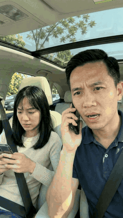
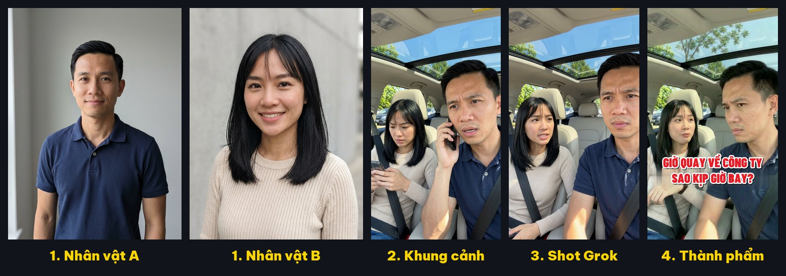

<div align="center">

# 🎭 AI-actor ad video

**Video quảng cáo kiểu tiểu phẩm với diễn viên do AI tạo. Bạn chỉ cần trò chuyện với agent.**

*Short UGC-style promo videos acted by AI-generated people — fixed faces, fixed voices, real captions — directed from your coding agent's chat.*

[](LICENSE)




**▶ [Xem bản có tiếng (MP4, 15 giây)](docs/demo.mp4)**

<sub>Hai nhân vật hư cấu do AI tạo. Toàn bộ hình, giọng và phụ đề được sinh và dựng tự động bằng pipeline trong repo này.</sub>

</div>

---

## Tạo ra cái gì?

Một video dọc 9:16 (hoặc 3:4, 16:9, 1:1) dài 30–60 giây, theo cấu trúc quảng cáo hay gặp trên TikTok và Reels:

> **Vấn đề** (tiểu phẩm) → **sản phẩm** (thẻ bật lên) → **demo màn hình** của bạn → **phản ứng** → **thẻ giá** → **kêu gọi hành động**

<p align="center"></p>

- 🧑‍🤝‍🧑 **Nhân vật giữ nguyên:** tạo ảnh chân dung một lần, rồi dùng làm tham chiếu cho mọi cảnh và mọi video.
- 🗣️ **Giọng giữ nguyên:** dùng giọng có sẵn của Grok (`eve`, `leo`, …), lời ngoài hình đọc bằng TTS cùng giọng. Hoặc lồng toàn bộ bằng 2 giọng Gemini cố định, căn khẩu hình theo từng âm tiết.
- 💬 **Phụ đề kiểu quảng cáo:** chữ to, viền dày, mỗi người nói một màu, hiện theo từng chữ (Whisper chạy trên máy), không bao giờ tràn khung.
- 🧩 **Ghép tư liệu của bạn:** demo màn hình (tắt tiếng gốc, lồng thuyết minh), thẻ sản phẩm hiện đúng lúc nhân vật nhắc tới, thẻ giá trên nền mờ.
- 💸 **Biết trước chi phí:** `check` ước tính tiền trước mọi bước tốn phí. Sai số so với thực tế dưới 2% (ước $3,59, thực tế $3,55 cho một chuỗi Omni 29 giây).
- ✅ **Có cổng duyệt:** kịch bản → nhân vật → bản cuối. Mỗi lần duyệt gắn với đúng phiên bản đó; sửa kịch bản là phải duyệt lại.
- 🔌 **Model để mở:** Grok `grok-imagine-video-1.5` (mặc định), Gemini Omni 1.2 Flash. Thêm model mới bằng một lớp provider.

## Bắt đầu trong 3 bước (Windows)

| | Bấm đúp | Làm gì |
|---|---|---|
| 1 | **`1-Cai-dat.cmd`** | Tạo `.venv`, cài gói Python, cài ffmpeg nếu thiếu. Không gọi API |
| 2 | **`2-Nhap-key.cmd`** | Dán key, ký tự không hiện ra khi gõ. Key lưu trong `local/secrets.env`, không đưa lên Git |
| 3 | **`3-Kiem-tra.cmd`** | Kiểm tra gói, ffmpeg, font và các key có trên máy |

Key cần có:
- `GROK_API_KEY` ([console.x.ai](https://console.x.ai)): sinh video và đọc giọng xAI.
- `GEMINI_API_KEY` ([AI Studio](https://aistudio.google.com)): ảnh nhân vật, video Omni, giọng Gemini.
- `GEMINI_TTS_MODEL`: chỉ cần khi dùng giọng Gemini.

Sau đó mở agent (Claude Code, Codex, …) trong thư mục này và nói, ví dụ:

> *"Làm video quảng cáo có diễn viên AI cho app hóa đơn của tôi: hai người trong xe, khách cần hóa đơn gấp, cô gái gợi ý xuất ngay trên điện thoại. Demo màn hình ở projects/hoadon/input/demo.mp4."*

Agent sẽ **hỏi khung hình**, **chốt kịch bản** với bạn, báo chi phí, rồi làm từng bước: ảnh nhân vật → từng shot (bạn xem và nghe) → giọng → dựng → `edit/final.mp4`.

## Cách hoạt động

```text
ad.json  ──check──►  ước tính $  ──approve script──►  ảnh nhân vật + khung cảnh  ──approve cast──►
gen (Grok / Omni) ──► words (Whisper) ──► voice (native | dub) ──► build ──► edit/final.mp4 ──approve final
```

| Lệnh | Việc |
|---|---|
| `init --aspect 9:16` | Tạo thư mục dự án và file `ad.json` mẫu |
| `check` | Kiểm tra kế hoạch và ước tính chi phí |
| `approve --gate script\|cast\|final` | Ghi lại lần duyệt, gắn với digest của đúng phiên bản |
| `gen --shot s1` | Sinh shot (tốn phí). Giữ lại các bản quay trước |
| `words` | Lấy mốc thời gian từng chữ, kiểm tra diễn viên nói đúng câu |
| `voice` | Lời ngoài hình hoặc lồng tiếng, căn khẩu hình, cân âm lượng |
| `build` | Ghép shot, đoạn chèn, thẻ, phụ đề và ảnh đè thành `edit/final.mp4` |
| `status` | Dự án đang ở bước nào, bước tiếp theo là gì |

Chạy bằng `.venv/Scripts/python.exe tools/ai_actor_ad.py <lệnh> --project <tên>`. Các lệnh tốn phí (`gen`, `voice`) chạy qua `tools/run_tool.py` để nạp key.

## Model video

| | Grok Imagine 1.5 (mặc định) | Gemini Omni 1.2 Flash |
|---|---|---|
| Giữ nhân vật | ≤ 14 ảnh tham chiếu, ghim khung đầu | Chuỗi nối tiếp liền mạch (≤ 30 giây) |
| Chọn giọng | ✅ ≤ 3 giọng có sẵn, trùng với xAI TTS | ❌ chỉ tả bằng chữ trong prompt |
| Giá 720p | khoảng $0,14/giây | khoảng $0,07/giây, cộng phí đọc lại đoạn trước |
| Tự chèn chữ lên hình | không thấy | có (pipeline tự xóa và phủ phụ đề lên) |

Chi tiết và các bài học rút ra: [`providers.md`](.agents/skills/video-ai-actor-ad/references/providers.md) · [`voices.md`](.agents/skills/video-ai-actor-ad/references/voices.md) · [`lessons.md`](.agents/skills/video-ai-actor-ad/references/lessons.md) · [`ad-json.md`](.agents/skills/video-ai-actor-ad/references/ad-json.md)

## Mỗi video nằm trong `projects/<tên>/`

```text
input/        file bạn đưa: video mẫu, demo màn hình, logo, thẻ sản phẩm
ad.json       kế hoạch: khung hình, nhân vật, shot và câu thoại, timeline, phụ đề
state.json    các lần duyệt, shot đã sinh, chi phí (do CLI ghi)
characters/   chân dung nhân vật        keyframes/  khung cảnh gốc
shots/        clip đã sinh và *.words.json
audio/        vo/ (lời ngoài hình), dub/ (lồng tiếng)
analysis/     ảnh ghép frame để soát
edit/         final.mp4 và project.md (nhật ký duyệt và chi phí)
```

## Dùng có trách nhiệm

- Chỉ dùng **người hư cấu** do AI tạo. Không dùng mặt hoặc giọng của người thật, không làm người nổi tiếng.
- Video mẫu chỉ để học cấu trúc. Chỉ ghép tư liệu bạn có quyền dùng.
- Giữ nguyên watermark của nhà cung cấp (SynthID, …). Khi đăng lên TikTok, YouTube hoặc Facebook, **bật nhãn nội dung AI**.

## Phát triển

```powershell
.venv/Scripts/python.exe -m unittest discover -s tests   # offline, provider giả lập, cần ffmpeg
.venv/Scripts/python.exe tools/doctor.py
```

Kiến trúc: [`AGENTS.md`](AGENTS.md). Để thêm một model video, viết một lớp provider trong `tools/video_chain.py`, thêm hàm soạn prompt trong `tools/ai_actor_ad/prompts.py` và một nhánh trong `generate.py`.

## Giấy phép

[MIT](LICENSE). Font trong `assets/fonts/` dùng giấy phép SIL OFL 1.1.
